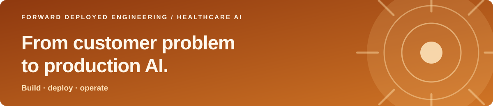

<h1 align="center">Daniel Zeltser</h1>

<strong>Forward Deployed Engineer · Healthcare AI · Product Builder</strong>

  <a href="https://danielzeltser.com">Portfolio</a> ·
  <a href="https://www.beaconhealth.ai/">Beacon Health</a> ·
  <a href="https://www.linkedin.com/in/danielzeltser1">LinkedIn</a> ·
  <a href="mailto:daniel.zeltser@duke.edu">Email</a>

I take ambiguous customer problems all the way to working software. At **[Beacon Health (YC W26)](https://www.beaconhealth.ai/)**, I own customer deployments from the first conversation through workflow design, agent engineering, launch, and production reliability. I also build internal tools and shared methods that help the team ship faster. I study biomedical engineering and AI at Duke University.

### What I'm building now

**[Beacon Health](https://danielzeltser.com/beacon-health) · Forward Deployed Engineer**

- **Own the customer loop:** 9 workflows across 3 clinical systems, supporting ~15K production AI-agent runs at a 98% success rate.
- **Build what the work needs:** replaced an external automation vendor with an internal tool in one week; one workflow now costs 91% less and saves about $5K per month.
- **Scale the approach:** turned my deployment process into a workflow-building method used by the engineering team, alongside reliability and platform work.

### Other projects

| Project | Focus |
| --- | --- |
| [Layra](https://danielzeltser.com/layra) | AI agents for medical billing and back-office healthcare operations, built from the needs of a real practice. |
| [BiliBright](https://danielzeltser.com/bilibright) | Low-cost neonatal jaundice screening device developed with Makerere University. |
| [Kwolify](https://danielzeltser.com/kwolify) | Recruiting workflow software for outreach, networking, and interview preparation. |

### Tools I use

**Languages & web**

   

**AI, deployment & prototyping**

     

<a href="https://danielzeltser.com"><strong>Explore my work →</strong></a>

